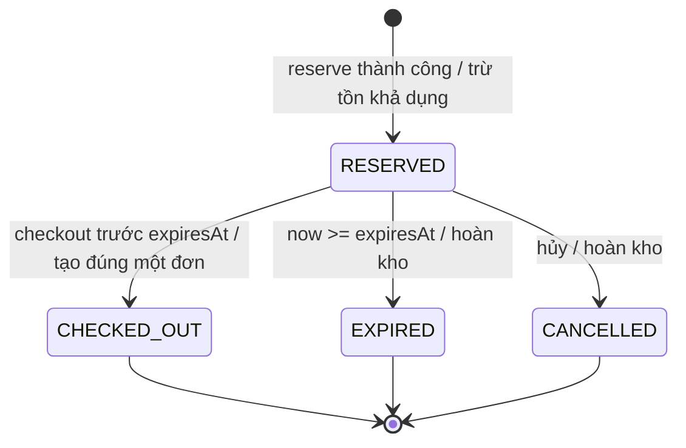

# Chớp! — HW3: High-Concurrency Flash-Sale E-Commerce Engine

Mô phỏng mega sale Việt Nam 11.11 bằng **React + TypeScript + Vite**, **Express 5 / Node.js 24** và **SQLite**. Giao diện tiếng Việt, giá VNĐ, đồng hồ mili giây, giữ hàng có hạn và checkout mô phỏng. Chạy local, không cần Docker, không thu tiền thật.

## 1. Chạy trên Windows

Yêu cầu: **Node.js 24 trở lên**, npm và Git. Database dùng `node:sqlite` tích hợp sẵn; không cần cài dịch vụ database hay module native bên ngoài.

```powershell
cd C:\Users\LEGION\Desktop\abc\lab-02-homework-3
npm.cmd ci
npm.cmd run dev
```

Mở **http://127.0.0.1:5173**. Backend ở `127.0.0.1:3001`; Vite proxy `/api` về backend. Dùng `npm.cmd` thay cho `npm` nếu PowerShell chặn `npm.ps1`; không cần thay Execution Policy.

Lần khởi động đầu tạo `data/flash-sale.sqlite`, 6 sản phẩm và lịch sale: **bắt đầu sau 30 giây, mở 10 phút, giữ hàng 60 giây**. Sale lưu trong database nên restart server không tự tạo sale mới.

Chạy bản build dùng chung một origin:

```powershell
npm.cmd run build
npm.cmd start
```

Mở **http://127.0.0.1:3001**. Dừng bằng `Ctrl+C`. Không chạy dev và start đồng thời trên cùng cổng.

### Tạo đợt sale mới

Dừng ứng dụng trước khi reset để các tab đang mở không thao tác với dữ liệu cũ.

```powershell
npm.cmd run db:reset
npm.cmd run dev
```

Lệnh reset xóa dữ liệu demo gồm đơn hàng, lượt giữ hàng và phiên mua, sau đó seed lại **trong cùng một transaction**. Nếu seed lỗi, dữ liệu cũ được giữ nguyên. Reset bị từ chối khi `NODE_ENV=production`.

### Cấu hình

Copy `.env.example` thành `.env` nếu cần. Biến môi trường của tiến trình ưu tiên hơn `.env`.

| Biến | Mặc định | Ý nghĩa |
| --- | --- | --- |
| `PORT` | `3001` | Cổng backend; nếu đổi, cập nhật target proxy trong `vite.config.ts` |
| `DB_PATH` | `data/flash-sale.sqlite` | File database, tương đối với thư mục chạy lệnh |
| `SALE_DELAY_MS` | `30000` | Thời gian chờ trước sale mới |
| `SALE_DURATION_MS` | `600000` | Thời lượng sale |
| `RESERVATION_TTL_MS` | `60000` | Thời hạn giữ hàng |

Thay `SALE_DELAY_MS` / `SALE_DURATION_MS` cần reset để thay lịch sale đã lưu. Thay TTL áp dụng cho lượt giữ mới; lượt giữ cũ giữ nguyên `expiresAt`. Ví dụ mở sale ngay:

```powershell
$env:SALE_DELAY_MS = "0"
npm.cmd run db:reset
npm.cmd run dev
```

## 2. Quy trình demo

1. Chờ đồng hồ sale về 0. Trước khi mở và sau khi đóng, không tạo được lượt giữ mới.
2. Chọn số lượng và **Giữ hàng**. Tồn khả dụng giảm ngay; đồng hồ giữ hàng xuất hiện trong **Đơn của tôi**.
3. Reload trang: khôi phục lượt giữ bằng ID trong localStorage và cookie phiên HttpOnly.
4. **Thanh toán mô phỏng** tạo một đơn hàng, hoặc **Hủy giữ hàng** hoàn kho. Để hết hạn cũng tự hoàn kho.
5. Mở cửa sổ ẩn danh để mô phỏng người mua khác. Hai tab cùng browser profile dùng chung phiên; hai cửa sổ ẩn danh thuộc cùng phiên ẩn danh cũng có thể dùng chung cookie.

Nếu phản hồi reserve bị mất sau khi server đã giữ hàng, nút **Thử lại yêu cầu** sử dụng cùng khóa idempotency, kể cả sau reload, để tránh giữ trùng. Sản phẩm dùng emoji hệ thống; font online có fallback Arial khi offline.

## 3. Kiến trúc và tính đúng đắn

```text
React ── cùng origin / Vite proxy ── Express API
                                      │
                            Inventory state machine
                                      │
                      SQLite WAL + BEGIN IMMEDIATE
                  sale / products / sessions / reservations / orders
```

Các thư mục chính: `client/` chứa giao diện và `anti-drift-timer.ts`; `server/` chứa API, database và nghiệp vụ; `shared/` chứa kiểu dữ liệu API; `tests/` chứa unit, integration, concurrency và browser tests.

### Đồng hồ chống trôi

`createAntiDriftTimer(durationMs, onTick)` ghi `targetTime = Date.now() + durationMs`. Mỗi `requestAnimationFrame` tính lại `Math.max(0, targetTime - Date.now())`; không trừ dần theo số lần callback. Hàm trả về cleanup hủy frame, kể cả khi gọi cleanup ngay trong `onTick`.

Khi tab nền bị ngừng render, đồng hồ nhảy về thời gian còn lại đúng ở frame tiếp theo, không cộng dồn sai số callback. Frontend ước lượng chênh lệch đồng hồ bằng `serverTime - midpoint(thời gian gửi, thời gian nhận)` và đồng bộ lại khi trở về tab. Sai số mạng còn phụ thuộc RTT và tính đối xứng đường truyền; “zero drift” ở đây là không tích lũy sai số scheduler, không phải bảo đảm đồng bộ mạng chính xác tuyệt đối. Thời gian backend quyết định quyền mua và hết hạn.

`setInterval` chỉ dùng để **poll dữ liệu** mỗi 2 giây và **quét expiry** mỗi giây, không dùng làm countdown. Điều kiện nghiệp vụ kiểm tra deadline trực tiếp nên không phụ thuộc độ đúng giờ của sweeper.

### State machine giữ hàng



- `available` là lượng có thể giữ ngay. Bất biến: **available + tổng quantity RESERVED + tổng quantity CHECKED_OUT = initialStock** cho từng sản phẩm.
- Reserve dùng `UPDATE ... SET available = available - quantity WHERE available >= quantity`, kiểm tra số hàng cập nhật và ghi reservation trong cùng transaction. Không dùng phép đọc–ghi không được bảo vệ hay mutex chỉ trong bộ nhớ.
- SQLite `BEGIN IMMEDIATE` tuần tự hóa writer, WAL hỗ trợ reader; timeout khóa là 5 giây. Điều kiện cập nhật tồn kho và trạng thái bảo vệ chuyển trạng thái. Đây là kiểm soát đồng thời ở database, không phải hệ thống distributed lock.
- Lấy `now` **sau khi giành được write lock**; tại đúng `expiresAt`, reservation đã hết hạn. Quét expiry trước thao tác và khi startup. Nếu checkout bị từ chối vì hết hạn, việc hoàn kho vẫn được commit.
- Hủy và expiry chỉ hoàn kho sau khi chuyển từ `RESERVED`. Checkout không trừ kho lần hai, lưu giá tại thời điểm reserve; `UNIQUE(reservation_id)` bảo đảm một đơn cho mỗi lượt giữ.
- Sale mở khi `startsAt <= now < endsAt`. Sau khi sale đóng, lượt giữ hợp lệ đã có vẫn được checkout trước deadline riêng.
- Reserve lặp cùng phiên, khóa và payload trả lại reservation cũ, kể cả khi reservation đã kết thúc. Dùng cùng khóa với payload khác trả `409 IDEMPOTENCY_CONFLICT`. Muốn mua lần mới cần khóa mới.
- Cookie phiên là token ngẫu nhiên do server cấp, HttpOnly, SameSite=Strict, hạn 7 ngày. Mọi truy cập reservation kiểm tra chủ sở hữu; ID trong localStorage không cấp quyền truy cập. Origin khác hoặc không hợp lệ bị từ chối.

### API

Mọi response API có `Cache-Control: no-store`. Giá là số nguyên VNĐ; timestamp là Unix epoch mili giây. Reserve nhận số lượng nguyên `1..100`; giao diện cung cấp `1..10`.

| Method | Route | Nội dung / kết quả |
| --- | --- | --- |
| GET | `/api/sale` | `{ serverTime, startsAt, endsAt, reservationTtlMs, products }` |
| POST | `/api/reservations` | Body `{ productId, quantity }`, header `Idempotency-Key`; trả `201 { serverTime, reservation }` |
| GET | `/api/reservations/:id` | `200 { serverTime, reservation }` của phiên sở hữu |
| POST | `/api/reservations/:id/checkout` | Tạo đơn hoặc trả lại cùng đơn nếu đã checkout |
| POST | `/api/reservations/:id/cancel` | Hủy và hoàn kho đúng một lần |

`Idempotency-Key`: 8–128 ký tự chữ, số, `_`, `-`; UUID là lựa chọn phù hợp. Reservation gồm `id`, `productId`, `quantity`, `unitPrice`, `status`, `createdAt`, `expiresAt`, `orderId` (null khi chưa có đơn).

Lỗi có dạng `{ "error": { "code": "OUT_OF_STOCK", "message": "..." } }`: `400` dữ liệu/JSON sai, `403` Origin sai, `404` không tồn tại/không sở hữu, `409` xung đột nghiệp vụ, `413` body quá lớn, `503` database bận. Với lỗi mạng hoặc `503`, retry bằng **cùng khóa**, không tạo khóa mới.

## 4. Kiểm thử

```powershell
npm.cmd run typecheck
npm.cmd test
npm.cmd run test:concurrency
npm.cmd run build
npm.cmd run test:e2e
```

Browser tests mặc định dùng **Microsoft Edge đã cài trên Windows**. Chạy build trước E2E; dừng server dev/start để giải phóng cổng 3001. E2E tự khởi động server với file database riêng `data/e2e-*.sqlite`, sale mở ngay, TTL 10 giây; không dùng file demo chính. Screenshot và trace lỗi lưu trong `test-results/` (Git ignore).

| Nhóm | Nội dung xác minh |
| --- | --- |
| Timer | Callback trễ/tab nền, deadline, không âm, duration 0/âm, cleanup, NaN/Infinity |
| Inventory | Giữ hàng, payload lặp/xung đột, hủy/checkout lặp, quyền sở hữu, giá cố định, biên sale/expiry, rollback khi lỗi ghi |
| Database | CHECK constraints; reset seed lỗi không làm mất dữ liệu |
| HTTP / dev proxy | Cookie HttpOnly/SameSite, lỗi JSON, Origin, mã trạng thái, API không tồn tại; Vite proxy thật cho reserve/cancel |
| Concurrency | 100 HTTP requests qua 4 tiến trình/kết nối SQLite độc lập tranh 10 sản phẩm: 10 thành công, 90 hết hàng; checkout lặp 20 lần, race cancel/expiry, conservation, restart |
| E2E desktop + mobile | Mua → reload → checkout, hai phiên độc lập, hoàn kho, expiry, mất phản hồi rồi retry cùng khóa, lỗi API, lọc/tìm kiếm, không overflow; lệch clock browser +30 giây và waiting/live/ended |

Kết quả lỗi AI thực tế và regression tests được trình bày trong [AI_FAILURE_AUDIT.md](AI_FAILURE_AUDIT.md).

Kết quả đã chạy ngày 25/10/2026: **14 tests backend/timer/proxy qua, 12 browser tests qua, typecheck và build qua**. Lệnh `npm.cmd run dev` và `npm.cmd run db:reset` đã được smoke test với database riêng.

## 5. Giới hạn và tiêu chí đề bài

Đây là demo local, không phải kiến trúc phục vụ tải production như Shopee/Lazada. SQLite có một writer tại một thời điểm; ứng dụng dùng API SQLite đồng bộ và mọi snapshot có quét expiry trong write transaction nên thông lượng bị giới hạn. Chưa có thanh toán thật, đăng nhập người dùng, rate limit, hàng đợi, giám sát production hay database migration cho schema đã thay đổi. Phiên anonymous và idempotency chống lỗi thao tác, không chống một người dùng tạo nhiều phiên để ôm hàng.

Server chỉ bind loopback HTTP; cookie không bật Secure vì môi trường local. Nếu triển khai thật phải thiết kế lại HTTPS, xác thực, vận hành database và kiểm thử tải theo hạ tầng thực tế. File runtime, `.env`, dependency và build không đưa vào Git.

| Tiêu chí HW3 | Bằng chứng |
| --- | --- |
| Vietnam mega sale | Giao diện Chớp! 11.11, tiếng Việt, VNĐ |
| Zero-drift timer | `client/anti-drift-timer.ts` và timer tests |
| Inventory state machine | `server/inventory.ts`, transaction, expiry, checkout và concurrency tests |
| Ít nhất 3 lỗi AI | `AI_FAILURE_AUDIT.md`, có tái hiện và regression test |
| Ít nhất 8 atomic commits | `git log --oneline --reverse`, Conventional Commits |

Các commit được chia theo từng phần chức năng. Xem [TASK_DECOMPOSITION.md](TASK_DECOMPOSITION.md) để theo dõi công việc và thứ tự push lên GitHub.
